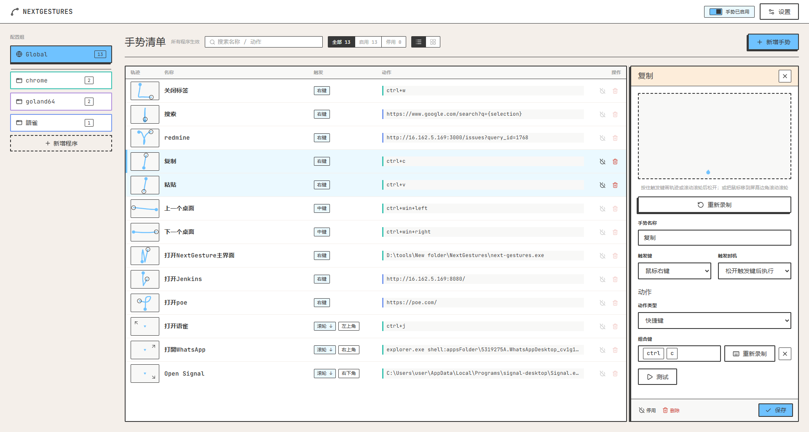

<div align="center">
  

  # NextGestures

  一款轻量、可自由定制的 Windows 鼠标手势工具

</div>

<div align="center">
  
</div>

## 这是什么

NextGestures 是一个运行在系统托盘中的 Windows 鼠标手势工具：按住触发键（右键 / 中键 / 侧键）在屏幕上滑出一段轨迹，即可执行对应的动作——发送快捷键、按时序回放键盘操作、打开网址、快速启动程序。手势可以按「当前前台程序」分组，不同软件下同一个手势也能触发不同动作。

## 缘起

灵感主要来自 [WGesture](https://github.com/lujjjh/WGesture)，一款体验很好的 Windows 鼠标手势软件。但它在我的新电脑上运行时存在兼容性问题，且项目已经很久没有更新维护了，于是自己动手开发了这款平替版本。

## 功能特性

- **手势识别**：以右键 / 中键 / 侧键 1 / 侧键 2 作为触发键，绘制任意方向轨迹并配合滚轮组合；支持屏幕区域限定触发。
- **多种动作类型**：
  - 发送快捷键：用原生键盘钩子直接录制组合键
  - 快捷键序列：录制并按原有节奏回放一连串键盘操作
  - 打开网址（支持 `{selection}` 占位符，自动取剪贴板/选中文本并做 URL 编码）
  - 快速启动程序：从已安装程序列表中搜索并选择，无需手写命令；失败时弹出提示
- **屏幕边角手势**：手势可绑定到屏幕边缘或四角，除滚轮外还支持在边角单击右键 / 中键 / 侧键，或停留指定时长（100 ~ 10000 毫秒）触发。全屏应用前台时不触发。
- **按程序分组配置**：除全局配置组外，可为指定 `.exe` 单独创建配置组，同一手势在不同程序下互不干扰。
- **应用黑名单**：在主界面左侧「黑名单」中手动添加进程名或拾取窗口，立即停用该应用的全部手势，保留浏览器等应用自带手势。
- **实时轨迹反馈**：绘制手势时窗口上会显示半透明轨迹叠加层（overlay），松开鼠标即刻触发。
- **冲突检测**：同一配置组内轨迹过于相似的手势会被自动标出，避免误触发。
- **单/双视图管理**：列表视图与卡片视图，支持按名称/动作搜索及启用状态筛选。
- **托盘常驻**：关闭主窗口不退出程序，可通过托盘菜单或全局热键快速启/停手势识别。
- **开机自启**：可在设置中一键开启/关闭。
- **自动更新**：启动时静默检测 GitHub 最新版本，发现新版本会弹窗提示更新日志，确认后自动下载安装并重启。

## 安装

前往 [Releases](../../releases) 下载最新的 Windows 安装包（`.exe`，基于 NSIS）并运行安装向导即可。

首次启动后，NextGestures 会常驻在系统托盘，双击或点击托盘图标即可打开设置窗口。

## 使用方法

1. **添加手势**：打开主窗口，点击右上角「新增手势」。
2. **录制轨迹**：选择触发键（右键 / 中键 / 侧键），按住并在屏幕任意位置画出想要的轨迹（可叠加滚轮方向作为组合条件）。
3. **配置动作**：为该手势选择要执行的动作类型（快捷键、快捷键序列、打开网址或快速启动程序），填写对应参数。
4. **（可选）限定生效程序**：默认手势对所有程序生效（Global）；如果只想在某个软件里生效，先在左侧「新增程序」创建一个绑定到该 `.exe` 的配置组，再在该组下添加手势。
5. **保存并使用**：保存后回到桌面任意界面，按住对应触发键画出轨迹即可触发动作。

**右键轨迹 + 终点左键点击**：录制时按住右键画出轨迹，在终点点击左键，最后松开右键。录制结果会自动勾选「终点左键点击」，也可以在已有右键轨迹上手动勾选。同一路径的纯轨迹与带点击轨迹可以分别绑定动作，不会互报轨迹冲突。

左键按下时固定轨迹终点，之后的移动、滚轮和重复左键点击不再追加；松开右键才执行动作。组合中的左键按下和抬起会被拦截，避免点到下层窗口。当前程序配置组或 Global 存在启用的右键组合手势时，该程序的右键手势统一等到松开后执行，为追加左键保留操作时间。旧配置默认保持纯轨迹条件。

**边角单击与停留**：在手势编辑器中把触发位置设为屏幕边缘或边角，动作方式可选滚轮、按键单击或停留。单击类手势可在边角原地点击来录制；没有匹配手势的单击会原样传递，拖动则交还给系统。停留触发每次进入边角只执行一次。边缘判定范围为最外侧 3 像素，边角沿两侧各延伸 32 像素。

**快速启动程序**：选择该动作后点击「选择程序」，在弹出的对话框中搜索程序名称或路径即可。旧版「运行命令」手势会显示为「旧版命令」，选择一个程序即可替换。

其他常用操作：

- 顶部开关可以一键启用 / 停用所有手势识别（也可在托盘菜单或全局热键中切换）。
- 手势列表右侧可以单独启用/停用或删除某条手势，重复/相似的轨迹会被标记「轨迹冲突」提示优化。
- 「设置」中可以调整轨迹颜色、匹配灵敏度、界面语言、开机自启等选项。
- 使用浏览器自带手势时，点击主界面左侧「黑名单」，输入如 `chrome.exe` 并添加，或点击「拾取窗口并加入」选择目标窗口。添加和移除会立即保存并生效；应用配置组中也可直接停用或恢复该应用手势。进程名忽略大小写，对该进程的所有窗口生效，优先于 Global 和应用专属配置，涵盖滚轮与边角手势。默认黑名单为空，旧配置可直接使用。

## 插件动作

截图、录屏和 QuickFormater 默认可用，在手势编辑器中直接选择对应动作即可。旧配置中的插件开关会被忽略，AI 设置会自动迁移。新配置从空手势列表开始。升级时会移除原有固定截图手势及未经自定义的两个示例手势。

### 区域截图并置顶

触发自己绑定的手势后，按住鼠标左键从第一个角拖至对角，松开即生成置顶贴图。框选期间按 Esc 或点击右键可取消。

贴图默认 100% 不透明，边缘带淡蓝色辉光和柔和阴影。按住图片即可原生拖动，滚轮调整透明度。贴图获得焦点时，按空格折叠为最多 64 × 64 像素的中央预览，再按空格恢复，折叠后也可移动。双击图片、右键或 Esc 可关闭贴图。支持多张贴图（最多 20 张），截图按屏幕物理像素处理。图片只保存在内存中，关闭贴图或退出程序即释放。

鼠标移到贴图上时，下方显示工具栏，可复制原图、保存 PNG、调整透明度和关闭；离开后自动收起。工具栏跟随贴图移动，屏幕底部空间不足时移到图片上方。复制、保存始终使用完整原图，不包含辉光、阴影或工具栏，也不受窗口透明度及折叠状态影响。

### 区域录屏

触发录屏动作后，左键拖选录制范围。松开后可在选区工具栏选择 720p、1080p 或原始分辨率，以及 15、24、30、60 或 120 FPS。720p 和 1080p 为上限，小选区保持原大小。点击「开始录制」后边框高亮。停止后可保存为 H.264 MP4 或 GIF 动图，GIF 使用单独的尺寸和帧率上限。录屏只录画面，实际可达帧率由屏幕刷新率、选区大小及硬件性能决定。

### QuickFormater

在「设置 → AI 设置」中填写 OpenAI 兼容服务的 Base URL、模型和 API Key。先在目标软件中选中文字，再触发对应手势。粤拼转换会显示繁体中文及粤拼，英语翻译会显示中文译文，英语优化用于润色并替换可编辑的选区。选中文字会发送给所配置的服务。密钥保存在当前用户的本地配置文件中，分享配置前请移除密钥。

## 技术栈

- 前端：React + TypeScript + Vite
- 桌面壳层：[Tauri 2](https://tauri.app/)
- 核心逻辑：Rust（`crates/core` 手势识别引擎，`crates/platform` Windows 平台交互，`src-tauri` 应用层）

## 本地开发

```bash
npm install
npm run tauri dev    # 启动开发环境
npm run tauri build  # 打包生成安装包
```
